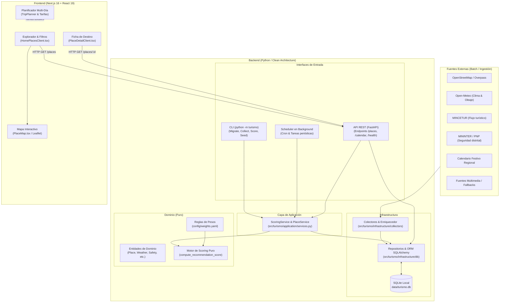
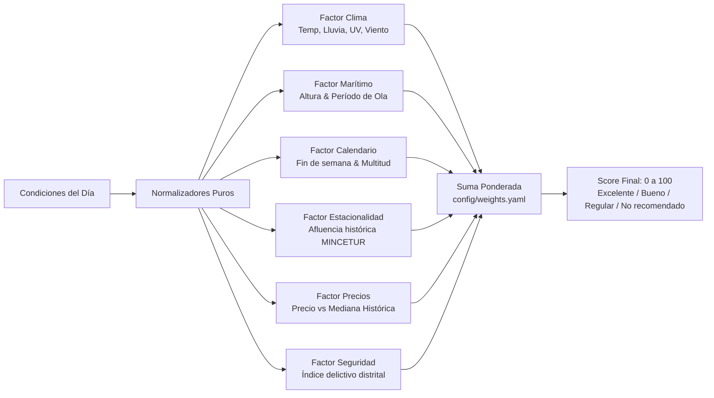
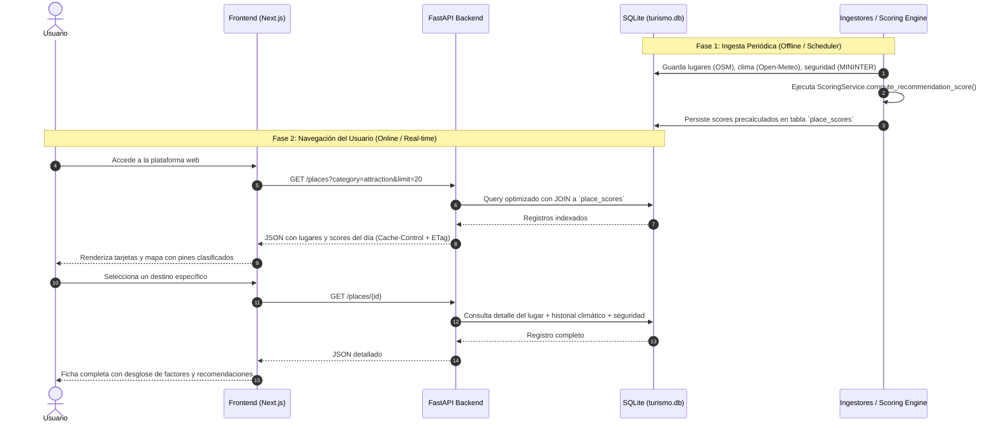

# Estructura y Funcionamiento del Sistema: Turismo La Libertad

Este documento describe la arquitectura, la organización de código, los flujos de datos y el funcionamiento interno del sistema **Turismo La Libertad**.

---

## 1. Visión General del Sistema

**Turismo La Libertad** es una plataforma de planeamiento y recomendación turística inteligente para el departamento de La Libertad, Perú (Trujillo, Huanchaco, Otuzco, Pacasmayo, Huamachuco, etc.).

Su propósito es responder tres preguntas fundamentales para viajeros, familias y turistas:
1. **¿A dónde ir?** (Lugares de interés, playas, patrimonio cultural, gastronomía y alojamiento).
2. **¿Cuándo ir?** (Identificación de mejores fechas según clima, oleaje, afluencia y eventos).
3. **¿Qué tan conveniente y seguro es el destino?** (Evaluación multidimensional determinista de conveniencia y riesgo).

### Principios de Diseño
- **Fuente de verdad local e inmutable:** La base de datos SQLite local (`data/turismo.db`) almacena datos georreferenciados, climatológicos, de seguridad y eventos. Durante la navegación del usuario no se consultan APIs externas lentas ni de pago.
- **Scoring determinista:** El cálculo de conveniencia se basa en funciones puras parametrizadas por configuración (`config/weights.yaml`). Mismos datos de entrada producen idéntico score (0 a 100).
- **Lectura ultra-rápida en API (Read-Hardened):** Los cálculos pesados y recolecciones ocurren en batch o vía background scheduler. Los endpoints `GET` devuelven datos precalculados e indexados con soporte para caché HTTP (`ETag`, `Cache-Control`).
- **Arquitectura Limpia / Hexagonal:** Separación estricta entre dominio (reglas de negocio puras), aplicación (casos de uso), infraestructura (base de datos, colectores, HTTP) e interfaces (API REST, CLI, Scheduler).

---

## 2. Diagrama de Arquitectura Global



---

## 3. Estructura del Repositorio

```text
lalibertad_predict/
├── alembic.ini                  # Configuración de migraciones de base de datos
├── pyproject.toml               # Dependencias Python, configuración de Ruff y Mypy
├── config/                      # Configuración declarativa del sistema
│   ├── classification.yaml      # Reglas para clasificar categorías de lugares
│   ├── events.yaml              # Calendario de fiestas patronales, festivales y feriados
│   └── weights.yaml             # Pesos y umbrales para el algoritmo de scoring
├── data/                        # Almacenamiento local de datos
│   ├── turismo.db               # Base de datos SQLite (fuente de verdad operacional)
│   ├── mincetur/                # Series estadísticas de afluencia mensual
│   ├── prices/                  # Muestras históricas de precios de hospedaje
│   └── seeds/                   # Semillas iniciales de POIs y criminalidad MININTER
├── src/turismo/                 # Código fuente del backend Python
│   ├── domain/                  # Entidades de negocio y reglas puras
│   ├── application/             # Servicios y orquestación de casos de uso
│   ├── infrastructure/          # Base de datos, colectores y clientes HTTP
│   ├── interfaces/              # API FastAPI, Scheduler y CLI
│   ├── config.py                # Pydantic Settings para variables de entorno
│   └── __main__.py              # Entrypoint CLI (`python -m turismo`)
├── frontend/                    # Aplicación web moderna en Next.js
│   ├── src/app/                 # App Router (páginas principales, [id], APIs internas)
│   ├── src/components/          # Componentes React (Mapa, Cards, Planificador, Métricas)
│   ├── src/lib/                 # Clientes API, utilidades y configuración
│   └── public/                  # Assets estáticos y recursos
├── scripts/                     # Scripts auxiliares de validación y auditoría
└── tests/                       # Suite de pruebas automatizadas (pytest)
```

---

## 4. Detalle de Capas del Backend (`src/turismo`)

### 4.1. Capa de Dominio (`src/turismo/domain/`)
Es el núcleo del sistema, completamente libre de dependencias de I/O, frameworks o base de datos.
- **`models.py`:** Define las entidades inmutables usando Pydantic y dataclasses (`Place`, `PlaceCategory`, `CoastType`, `WeatherDay`, `MarineDay`, `RecommendationResult`, `PlaceSafetyReport`).
- **`classification.py`:** Clasifica los puntos de interés en categorías turísticas (`lodging`, `attraction`, `food`, `activity`) a partir de etiquetas de OpenStreetMap.
- **`scoring.py`:** Contiene el algoritmo matemático puro de normalización y ponderación de factores de conveniencia turística.

### 4.2. Capa de Aplicación (`src/turismo/application/`)
Orquesta la lógica entre el dominio y la infraestructura.
- **`ports.py`:** Define contratos e interfaces abstractas para repositorios y colectores (Dependency Inversion).
- **`services.py`:**
  - `ScoringService`: Orquesta la lectura de condiciones meteorológicas, eventos y seguridad para calcular y persistir los scores de cada lugar para una fecha dada.
  - `find_nearest_location`: Algoritmo de geodistancia (fórmula de Haversine) para vincular cualquier punto geográfico de La Libertad con la estación meteorológica o nodo costero más cercano.

### 4.3. Capa de Infraestructura (`src/turismo/infrastructure/`)
Gestiona el acceso a datos externos, base de datos y red:
- **`db/`:**
  - `models.py`: Tablas SQLAlchemy (`places`, `locations`, `weather_daily`, `marine_daily`, `place_scores`, `safety_metrics`, etc.).
  - `repositories.py`: Consultas optimizadas con filtros, ordenación y paginación para evitar consultas N+1.
  - `session.py`: Sesiones SQLite con soporte de concurrencia y PRAGMAs optimizados (`WAL mode`, cache size, synchronous normal).
- **`collectors/`:**
  - `osm.py`: Extrae puntos turísticos (hoteles, atractivos, restaurantes) mediante la API Overpass de OpenStreetMap.
  - `open_meteo.py`: Descarga pronósticos meteorológicos (temperatura, precipitación, índice UV, viento) y marinos (altura y período de ola).
  - `events.py`: Parsea festividades regionales (p. ej. Festival de la Primavera, Feria de San José, Virgen de la Puerta).
  - `mincetur.py`: Ingesta factores de estacionalidad y volumen de turistas por mes.
  - `mininter.py`: Ingesta denuncias y estadísticas de seguridad por distrito policial para generar índices de criminalidad geolocalizados.
  - `hotel_prices.py`: Monitorea bandas de precios por tipo de habitación.
  - `enricher.py` e `image_collector.py`: Asocian imágenes verificadas, etiquetas de accesibilidad y detalles a cada lugar.

### 4.4. Capa de Interfaces (`src/turismo/interfaces/`)
Puntos de entrada al sistema:
- **`api/` (FastAPI):**
  - `main.py`: Endpoints REST (`/places`, `/places/{id}`, `/calendar`, `/health`). Aplica rate-limiting (`slowapi`), compresión Gzip y headers de caché.
  - `cache.py`: Middleware de caché en memoria con `ETag` para responder `304 Not Modified` ante consultas repetidas sin consultar la base de datos.
  - `schemas.py`: Esquemas Pydantic de respuesta HTTP documentados en OpenAPI/Swagger (`/docs`).
- **`scheduler.py`:** Tarea en segundo plano para refrescar pronósticos meteorológicos y recalcular scores diarios de forma automática.
- **`__main__.py`:** CLI interactiva que permite a los operadores ejecutar cualquier proceso del pipeline con comandos como `python -m turismo score 2026-11-08`.

---

## 5. El Motor de Scoring y Conveniencia

El sistema evalúa cada lugar turístico para una fecha específica mediante una fórmula matemática ponderada:

$$\text{Score} = 100 \times \frac{\sum (w_i \times f_i)}{\sum w_i}$$

Donde cada $f_i \in [0.0, 1.0]$ representa un subfactor normalizado, y $w_i$ es su peso configurado en `config/weights.yaml`.



### Factores Analizados
1. **Clima:** Castiga lluvias intensas o viento excesivo; premia temperaturas en el rango de confort térmico humano (18°C – 28°C).
2. **Marítimo:** Se aplica solo a destinos costeros (`coastal`), evaluando la seguridad para baño o surf según altura y período de ola.
3. **Calendario y Eventos:** Modela penalizaciones por saturación/multitudes o incentivos por feriados.
4. **Estacionalidad:** Ajusta según el volumen mensual típico de turistas en la región.
5. **Precios:** Evalúa si el costo actual del hospedaje está por encima o por debajo de su mediana histórica.
6. **Seguridad Ciudadana:** Indicador georreferenciado basado en denuncias por cada 10,000 habitantes a nivel distrital (MININTER).

---

## 6. Estructura y Funcionamiento del Frontend (`frontend/`)

El frontend está desarrollado con **Next.js 16 (App Router)**, **React 19**, **Tailwind CSS** y **Leaflet/OpenStreetMap**:

### Principales Módulos y Componentes
- **`HomePlacesClient.tsx`:** Es la vista principal. Implementa:
  - Búsqueda en tiempo real por texto y filtrado por categoría (`Atracciones`, `Hoteles`, `Gastronomía`, `Actividades`).
  - Filtro geográfico por provincias y distritos de La Libertad.
  - Ordenación dinámica (Mayor conveniencia, Mejor clima, Más seguros, Menor precio).
  - Vistas intercambiables: Cuadrícula de tarjetas, Lista compacta y Mapa interactivo.
- **`PlaceMap.tsx`:** Integración con Leaflet para renderizar marcadores con código de color según el score de conveniencia (Verde: >75, Ámbar: 50-74, Rojo: <50). Emplea tiles de OpenStreetMap sin suscripción a APIs comerciales.
- **`PlaceDetailClient.tsx`:** Vista de detalle (`/places/[id]`) que muestra:
  - Desglose factor por factor con barras de progreso y explicaciones legibles.
  - Pronóstico extendido y recomendaciones de equipamiento.
  - Auditoría de seguridad del distrito con recomendaciones para el viajero.
  - Lugares cercanos recomendados calculados por proximidad espacial.
- **`TripPlanner/`:** Generador interactivo de itinerarios multi-día. Permite seleccionar destinos, días de estancia y calcula el presupuesto estimado de transporte público local mediante el endpoint `/api/transit/fare`.
- **`HeatmapCalendar.tsx`:** Calendario interactivo tipo mapa de calor para identificar visualmente los días más convenientes del mes para viajar.

---

## 7. Flujo del Dato de Extremo a Extremo



---

## 8. Ciclo Operativo: Comandos y Despliegue

Para poner en marcha el sistema completo localmente o en un servidor:

### Paso 1: Configurar el entorno backend
```powershell
# Crear entorno virtual e instalar dependencias
python -m venv .venv
.venv\Scripts\python -m pip install --upgrade pip
.venv\Scripts\python -m pip install -e ".[dev]"
```

### Paso 2: Poblar la base de datos y calcular scores
```powershell
# Aplicar migraciones estructurales
.venv\Scripts\python -m turismo migrate

# Poblar catálogo de lugares, seguridad e imágenes
.venv\Scripts\python -m turismo seed-places-once
.venv\Scripts\python -m turismo collect-images
.venv\Scripts\python -m turismo seed-safety

# Calcular scores de recomendación para la fecha actual
.venv\Scripts\python -m turismo score
```

### Paso 3: Iniciar el Backend
```powershell
.venv\Scripts\python -m turismo api
# API operativa en: http://127.0.0.1:8000
# Documentación interactiva en: http://127.0.0.1:8000/docs
```

### Paso 4: Iniciar el Frontend
```powershell
cd frontend
npm install
npm run dev
# Aplicación web operativa en: http://localhost:3000
```
