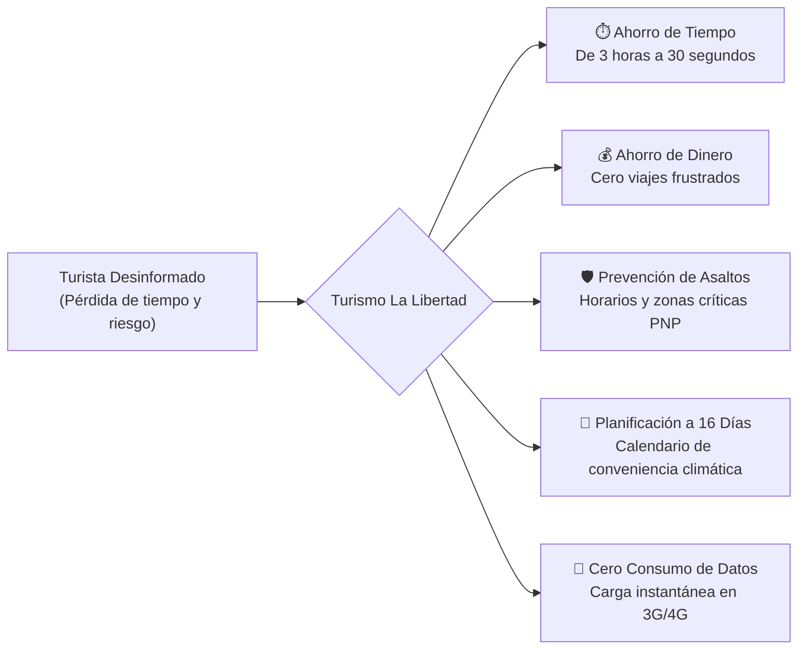
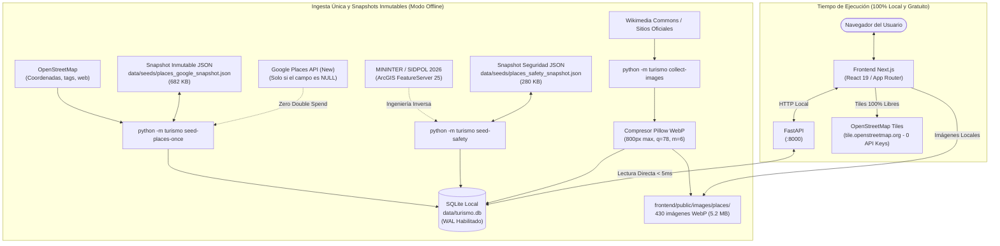
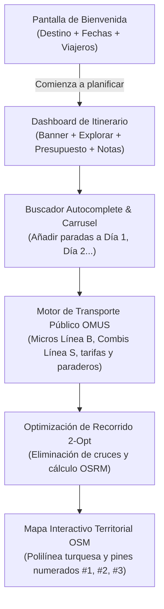

# Turismo La Libertad — Predictor de Conveniencia y Recomendación Turística

Sistema integral y determinista para planificar visitas turísticas en el departamento de **La Libertad, Perú** (Trujillo, Huanchaco, Chan Chan, Huacas de Moche, Puerto Chicama y Marcahuamachuco).

La plataforma combina datos meteorológicos, oceánicos, calendario de festividades, afluencia histórica, diagnóstico de seguridad policial georreferenciada y catálogo comercial verificado en una **base de datos local como única fuente de verdad (`data/turismo.db`)**, exponiéndolos mediante una API REST de alto rendimiento (FastAPI) y una aplicación web editorial con mapas libres OpenStreetMap (Next.js 16 + Leaflet).

---

## 💡 ¿Por Qué Debería Usarse? (¿Qué se le Ahorra Realmente al Usuario?)

La mayoría de plataformas turísticas tradicionales (Google Maps, TripAdvisor, Booking) están pensadas para **vender publicidad o intermediar comisiones**, no para cuidar el tiempo, el bolsillo ni la integridad física del viajero. Para visitar La Libertad, un turista promedio suele perder horas navegando entre múltiples páginas dispersas y, aun así, termina tomando decisiones a ciegas.

Este sistema fue concebido como una **herramienta de toma de decisiones de alta precisión**, resolviendo 5 problemas críticos:



### 1. ⏱️ Ahorro de Tiempo: De 3 Horas de Búsqueda a 30 Segundos
* **El problema habitual:** Para planificar un fin de semana en Trujillo, un turista tiene que abrir:
  1. *Windguru o Magicseaweed* para ver altura y período de olas en Chicama o Huanchaco.
  2. *SENAMHI o AccuWeather* para saber la radiación UV en el valle o lluvias en la sierra.
  3. *Google Maps* para estimar distancias.
  4. *TripAdvisor o foros* para ver opiniones (muchas veces infladas o desactualizadas).
  5. *Noticias policiales* para saber si la zona está tranquila.
* **Qué se le ahorra:** **El 95% del tiempo de investigación**. En una sola pantalla obtiene un **Score Determinista de 0 a 100**, que consolida temperatura, viento, radiación, estado del mar, afluencia y seguridad sin cambiar de pestaña.

### 2. 💰 Ahorro de Dinero: Cero Viajes Frustrados y Sobreprecios
* **Evita el "viaje en vano" a Chicama:** Viajar a Puerto Malabrigo toma 2 horas de ida y 2 de vuelta desde Trujillo (~S/ 150 a S/ 300 entre combustible, peajes o colectivos). Llegar a la playa y encontrar el mar plano o con viento cruzado arruina el presupuesto del surfista. El sistema califica el oleaje (altura en metros y período en segundos) con antelación.
* **Evita el temporal en Marcahuamachuco:** Subir a más de 3,200 msnm (4 a 5 horas de ruta de montaña) en un día de granizada o neblina espesa significa perder un día completo de vacaciones y pagar transporte en vano.
* **Elimina intermediarios y "jaladores":** Los comercios y servicios muestran distancias reales a pie y contactos directos formales, evitando comisiones a jaladores callejeros en la Plaza de Armas o sobrecostos para turistas desinformados.

### 3. 🛡️ Seguridad Personal: Prevención de Asaltos y Delincuencia (Datos Oficiales PNP)
Trujillo y la costa norte presentan desafíos reales de seguridad urbana. La mayor duda de una familia o turista solitario es: *¿Es seguro caminar por aquí? ¿A qué hora debo regresar al hotel?*
* **Lo que NO te dicen las apps comerciales:** Google Maps o TripAdvisor jamás te alertarán si una calle registra robos constantes de celulares o asaltos al anochecer.
* **Lo que hace este sistema:** Se conecta a las estadísticas policiales reales de **SIDPOL (MININTER 2026)** en un radio perimétrico de 1,000 m y responde de frente:
  * **Cuándo NO ir:** Indica claramente las horas de alto riesgo (por ejemplo: *18:30 a 05:00 hrs*, franja que concentra el 63% de los incidentes en el centro histórico, con especial cuidado en fines de semana).
  * **Cuándo SÍ ir:** Recomienda la ventana óptima con patrullaje preventivo y luz solar (*09:00 a 16:30 hrs*).
  * **De qué cuidarse:** Avisa qué modalidades delictivas predominan en ese punto exacto (arrebato de celulares en la calzada, carteristas en esquinas comerciales, estafas en tours informales).
* **Qué se le ahorra:** El robo de su teléfono móvil, dinero, pasaporte, o situaciones de riesgo físico para el viajero y su familia.

### 4. 📅 Planificación Inteligente con 16 Días de Anticipación (Calendario Heatmap)
Si el usuario viaja la próxima semana, no tiene que adivinar qué día visitar las Huacas de Moche, cuándo ir a Chan Chan o cuándo bañarse en Huanchaco. El **mapa de calor de 16 días** le indica con exactitud qué fecha tiene la combinación ideal de cielo despejado, menor radiación UV extrema y condiciones óptimas de visita.

### 5. 🎯 Cero Sesgo Comercial ni Reseñas Manipuladas
* En las plataformas tradicionales, los primeros resultados son anuncios pagados o negocios con campañas de marketing agresivas.
* En **Turismo La Libertad**, el algoritmo de recomendación es **100% matemático y de código abierto**:
  * Un hotel o restaurante gana puntaje por su cercanía real al atractivo, precios competitivos frente a la mediana del distrito y datos formales de contacto.
  * Ningún negocio puede pagar para subir en el ranking.

### 6. 📱 Carga Ultrarrápida y Ahorro de Megas en el Celular (Ideal en Ruta y 3G/4G)
* Las páginas de turismo convencionales descargan megabytes de scripts pesados, rastreadores publicitarios y fotos gigantescas sin comprimir.
* Este sistema corre sobre una arquitectura ultraligera:
  * **Imágenes WebP autoalojadas:** Cada foto pesa apenas ~12 KB (5.2 MB para todo el catálogo de 430 lugares).
  * **Mapas libres OpenStreetMap:** Sin scripts bloqueantes de Google Maps.
  * Carga instantánea en carreteras y zonas rurales donde la señal móvil baja a 3G o Edge.

---

## 1. Arquitectura de Cero Llamadas Externas en Tiempo de Ejecución

El sistema opera bajo los principios estrictos de **cero costos recurrentes, cero fugas de datos, cero dependencia en red durante la navegación del usuario y cero alucinaciones**:



### Principios Fundamentales del Sistema:
1. **Base de Datos Local como Fuente de Verdad (`data/turismo.db`)**:
   * Ni la interfaz web ni los endpoints de la API (`/places`, `/places/{id}`, `/places/{id}/nearby`, `/places/{id}/safety`) realizan peticiones externas a APIs de terceros durante las consultas de los usuarios.
   * Toda respuesta se sirve directamente de SQLite en menos de 5 milisegundos.
2. **Respaldos Inmutables en JSON**:
   * **Comercial:** `data/seeds/places_google_snapshot.json` (682 KB) contiene estrellas, conteo de reseñas, comentarios, direcciones y teléfonos.
   * **Seguridad:** `data/seeds/places_safety_snapshot.json` (280 KB) contiene los diagnósticos criminalísticos de SIDPOL (turnos, horas críticas, conteo de denuncias, recomendaciones).
   * Al reconstruir la base de datos desde cero, estos snapshots pueblan el sistema al instante sin consumir cuotas de API ni costos de nube.
3. **Idempotencia y Cero Gasto Doble**:
   * El recolector solo consulta APIs remotas si `stars IS NULL` y `google_place_id IS NULL`. Si el dato ya existe en la base local, la consulta externa se omite por completo.
4. **Cero Alucinaciones y Renormalización Matemática**:
   * Si un establecimiento carece de datos verificados, se almacena `NULL`. El motor `ScoringService` renormaliza la suma de pesos disponibles sin inventar datos ni penalizar injustamente.

---

## 2. Diagnóstico Georreferenciado de Seguridad (MININTER / SIDPOL PNP 2026)

Se integró un sistema oficial de seguridad ciudadana mediante **ingeniería inversa** del [Mapa del Delito Georreferenciado del Ministerio del Interior](https://aplicaciones.mininter.gob.pe/mapadeldelitogeoreferenciado/):

* **Endpoint de Datos:** FeatureServer público de ArcGIS:
  `https://services6.arcgis.com/lMIZrqiJkpM748BR/arcgis/rest/services/SIDPOL_DELITOS_TOTAL/FeatureServer/25/query`
* **Parámetros Geográficos:** Consulta perimétrica en radio de **1,000 metros** georreferenciados en torno a cada lugar.
* **Clustering por Proximidad:** Durante la recolección, se agrupan coordenadas a menos de 250 m de distancia para minimizar las peticiones al servidor público y evitar sobrecargas.
* **Diagnóstico Incluido para el Viajero:**
  * **Índice de Seguridad Territorial (0 a 100):** Escala objetiva calibrada según la densidad de denuncias policiales registradas en 2026 en el cuadrante de 1 km:
    * **0 denuncias (Score 98/100):** *Marcahuamachuco (#6)* &bull; Muy Seguro / Sin horas críticas detectadas.
    * **1 a 10 denuncias (Score 90–97/100):** *Chan Chan (#3, 3 denuncias)* &bull; Muy Seguro.
    * **11 a 50 denuncias (Score 80–89/100):** *Huacas del Sol y de la Luna (#4, 11 denuncias)*, *Puerto Chicama (#5, 20 denuncias)* &bull; Seguro.
    * **51 a 200 denuncias (Score 65–79/100):** *Huanchaco (#2, 136 denuncias)* &bull; Moderado.
    * **> 800 denuncias (Score 40–50/100):** *Centro Histórico de Trujillo (#1, #303, #305, ~1,933 denuncias)* &bull; Riesgo Urbano / Desfavorable de Noche (alta incidencia de arrebato de celulares y carteristas en áreas de aglomeración).
  * **Cuándo NO ir (Horarios No Recomendados):** Identificación automática de las franjas de riesgo (generalmente `18:30 a 05:00 hrs`, correspondiente a los turnos Noche y Madrugada).
  * **Alerta de Días Críticos:** Advertencia de mayor incidencia en fines de semana (viernes noche a domingo) y feriados locales.
  * **Horario Óptimo Recomendado:** Ventana sugerida de recorrido seguro (generalmente `09:00 a 17:00 hrs`) con presencia de serenazgo, patrullaje policial preventivo e iluminación natural.
  * **Distribución de Denuncias por Turno:** Desglose porcentual y numérico por turnos PNP: `Mañana`, `Tarde`, `Noche` y `Madrugada`.
  * **Modalidades Delictivas Frecuentes:** Arrebato de celulares, hurto simple de pertenencias, estafas comerciales.
  * **Recomendaciones Preventivas:** Consejos de autoprotección adaptados a los delitos detectados en la zona.
* **Componente Interactivo (`PlaceSafetyModal.tsx`):** Ventana modal accesible con un clic desde el distintivo de seguridad o el botón de diagnóstico completo.

---

## 3. Mapas Territoriales 100% Libres y Calibración de Coordenadas

### Cartografía OpenStreetMap y Leaflet (`PlaceMap.tsx`)
* **Servidor de Teselas:** Teselas oficiales de **OpenStreetMap Estándar** (`https://tile.openstreetmap.org/{z}/{x}/{y}.png`).
  * **Sin API Keys:** Eliminación total de dependencias propietarias (CartoDB, Google Maps JS API).
  * **Cero Marcas de Agua:** Mapas limpios, neutrales y sin advertencias de clave requerida.
* **Montaje en Cliente:** Carga asíncrona vía `next/dynamic` (`ssr: false`) para evitar desajustes en el DOM.
* **Marcadores Visuales Temáticos:**
  * **Marcador Terracota Mochica (`★`):** Punto central del destino consultado.
  * 🛏️ **Alojamiento (Índigo):** Hoteles y hostales recomendados cercanos.
  * 🍽️ **Gastronomía (Ámbar):** Restaurantes y cevicherías verificadas.
  * 🏄 **Actividad (Turquesa):** Tours y escuelas de surf.

### Calibración de Coordenadas Geográficas WGS84
Se corrigieron los desvíos geográficos históricos en la base de datos y archivos de configuración:
* **Puerto Chicama (Malabrigo):** Calibrado a `-7.694431, -79.438941` (eliminado desvío previo de ~17 km en el mar).
* **Huacas del Sol y de la Luna:** Calibrado a `-8.133583, -78.990853` (corregido desvío de ~3 km al sur).
* **Plaza Mayor de Trujillo:** `-8.111786, -79.028667`.
* **Balneario de Huanchaco:** `-8.078560, -79.121384`.
* **Chan Chan (Templo Nik An):** `-8.109858, -79.074533`.
* **Marcahuamachuco:** `-7.787071, -78.076645`.

---

## 4. Pipeline de Imágenes WebP Autoalojadas (< 6 MB Total)

Para asegurar soberanía de datos y descartar cualquier cobro por tráfico de imágenes:

1. **Eliminación de Google Photos:** Cero enlaces a dominios `googleapis.com` o `googleusercontent.com`.
2. **Filtro Estricto de Relevancia:** Se reemplazó la geobúsqueda perimétrica abierta por búsqueda semántica con verificación de tokens en Wikimedia Commons, evitando falsos positivos (como fotos de comida asignadas a palacios o monumentos).
3. **Imágenes Patrimoniales Verificadas:**
   * **Palacio Iturregui (#303):** Fachada neoclásica republicana (`place_303.webp`).
   * **Huaca La Esmeralda (#304):** Frisos ceremoniales zoomorfos Chimú (`place_304.webp`).
   * **Museo del Juguete (#305):** Casona virreinal de la cuna del museo (`place_305.webp`).
   * **Museo Arqueológico UNT (#308):** Fachada patrimonial del museo universitario.
4. **Optimización con Pillow (PIL):**
   * Redimensión a 800px de ancho máximo preservando relación de aspecto.
   * Compresión `.webp` con `quality=78, method=6`.
   * **Total:** 430 imágenes optimizadas en `frontend/public/images/places/` ocupando apenas **5.2 MB** (~12 KB por imagen).
5. **Fallbacks Estéticos Locales:** En `frontend/public/images/defaults/` (`default_attraction.webp`, `default_lodging.webp`, `default_food.webp`, `default_activity.webp`).

---

## 5. Clasificación y Scoring Diferenciado

Cada lugar registrado pertenece obligatoriamente a uno de 4 tipos (`PlaceKind`), clasificado según las reglas de [`config/classification.yaml`](config/classification.yaml):

| Tipo (`kind`) | Lugares | Índice Aplicado | Factores Evaluados |
| :--- | :---: | :--- | :--- |
| **`attraction`** | **43** | **Índice de Conveniencia** (`convenience_score`) | Clima diario (Open-Meteo), oleaje costero (Huanchaco/Chicama), afluencia estacional (MINCETUR) y festividades/Semana Santa. |
| **`lodging`** | **187** | **Índice de Recomendación** (`recommendation_score`) | Precio relativo vs mediana local, completitud de contacto (web, teléfono), horario, calificación externa verificada y cercanía al atractivo. |
| **`food`** | **195** | **Índice de Recomendación** (`recommendation_score`) | Tipo de cocina, completitud de menú/contacto, calificación verificada, distancia y horarios. |
| **`activity`** | **5** | **Índice de Recomendación** (`recommendation_score`) | Disponibilidad de tours/surf, contacto verificado y proximidad territorial. |

> [!NOTE]
> Los índices **nunca se mezclan**: los hoteles y restaurantes nunca compiten con atractivos arqueológicos o naturales dentro del mismo ranking.

---

## 6. Endpoints de la API REST (FastAPI)

La API corre por defecto en `http://127.0.0.1:8000` con documentación OpenAPI interactiva en `/docs`:

| Método | Endpoint | Descripción |
| :--- | :--- | :--- |
| `GET` | `/places` | Lista de atractivos con filtros por zona (`coastal`/`inland`), fecha y paginación. |
| `GET` | `/places/{id}` | Detalle completo del lugar: coordenadas, calificación, reseñas, ofertas y reporte de seguridad. |
| `GET` | `/places/{id}/safety` | **Nuevo:** Diagnóstico oficial de seguridad territorial georreferenciada (MININTER / SIDPOL). |
| `GET` | `/places/{id}/nearby` | Comercios cercanos recomendados (`lodging`, `food`, `activity`) ordenados por proximidad y score. |
| `GET` | `/places/{id}/calendar` | Matriz de conveniencia de 16 días con previsión meteorológica y oleaje. |
| `GET` | `/health` | Chequeo de salud del servicio y conectividad con la base de datos local. |

---

## 7. Estructura del Proyecto

```text
sql-caido-rescube/
├── config/
│   ├── classification.yaml          # Reglas OSM -> PlaceKind (4 tipos)
│   ├── events.yaml                  # Calendario de festividades y aglomeración
│   └── weights.yaml                 # Ponderación determinista por categoría
├── data/
│   ├── seeds/
│   │   ├── places_google_snapshot.json # Respaldo comercial inmutable (682 KB)
│   │   └── places_safety_snapshot.json # Respaldo de seguridad MININTER (280 KB)
│   └── turismo.db                   # Base de datos SQLite (WAL habilitado)
├── src/turismo/
│   ├── domain/                      # Modelos puros Pydantic v2, fórmulas de scoring y Haversine
│   ├── application/                 # Servicios de scoring, conveniencia y puertos de datos
│   ├── infrastructure/
│   │   ├── collectors/              # osm, open_meteo, events, mincetur, mininter, enricher, image_collector
│   │   ├── db/                      # Modelos SQLAlchemy ORM, repositorios y migraciones Alembic
│   │   └── http/                    # SafeHttpClient con protección SSRF y timeouts
│   └── interfaces/
│       ├── api/                     # FastAPI (rutas /places, /safety, /calendar, cache)
│       └── scheduler.py             # Planificador de recolección climática periódica
├── frontend/                        # Next.js 16 (App Router + Tailwind CSS)
│   ├── public/images/
│   │   ├── places/place_{id}.webp   # 430 fotos WebP optimizadas autoalojadas
│   │   └── defaults/                # Fallbacks estéticos por categoría
│   └── src/
│       ├── components/              # PlaceMap (Leaflet), PlaceSafetyModal, HomePlacesClient, PlaceDetailClient
│       └── lib/                     # Tipos TypeScript y clientes API
├── scripts/                         # Utilidades de calibración y verificación
└── ATTRIBUTION.md                   # Licencias y créditos Creative Commons de imágenes
```

---

## 7. Planificador de Viajes Multi-Día (Estilo Wanderlog + Transporte Público OMUS)

El portal principal (`/`) implementa un planificador de viajes de vanguardia que elimina el desorden de listas estáticas de destinos y permite crear itinerarios multi-día interactivos:



### Características Principales:
1. **Flujo de Entrada Limpio:** No abruma al usuario con cientos de tarjetas; inicia con un formulario de destino (`¿A dónde?`), selección de fechas y creación del viaje.
2. **Conexiones Reales de Transporte Masivo (GTFS Trujillo-OMUS):**
   * Entre parada y parada (ej. Plaza Mayor &rarr; Balneario de Huanchaco), el sistema consulta la base local de 125 rutas de transporte de Trujillo (`prueva_maps/Trujillo-OMUS/data.json`).
   * Despliega la tarjeta de trasbordo con:
     * Nombre y código de la línea: ej. `Microbús Línea B ("La B de Huanchaco") [M-06 B]` o `Combi Línea S ("La S de Sol y Luna") [C-14 S]`.
     * Tarifa exacta en soles: `S/ 2.50` (o `Gratis` en tramos a pie).
     * Tiempo estimado en minutos.
     * Paraderos de subida y bajada con instrucciones de abordaje.
3. **Cálculo de Presupuesto en Tiempo Real:** El widget de presupuesto suma de forma dinámica el gasto exacto en pasajes del día planificado.
4. **Optimización de Rutas (2-Opt / Nearest-Neighbour):** Algoritmo local que reordena las paradas para minimizar la distancia kilométrica y el tiempo en ruta, conectándose a la geometría de calles mediante el motor OSRM.
5. **Persistencia Local Inmutable:** Persiste el estado del viaje, notas del viajero, paradas y hotel ancla en `localStorage` / caché local del navegador sin sobrecargar la base de datos central.

---

## 8. Guía de Ejecución y Comandos CLI

### Backend (Python 3.11+ / FastAPI)

```powershell
# 1. Aplicar migraciones de base de datos
.venv\Scripts\python -m turismo migrate

# 2. Ingesta offline de datos comerciales (lee snapshot local sin llamadas a Google)
.venv\Scripts\python -m turismo seed-places-once

# 3. Descarga y optimización de imágenes libres WebP
.venv\Scripts\python -m turismo collect-images

# 4. Ingesta y snapshot de seguridad oficial MININTER / SIDPOL
.venv\Scripts\python -m turismo seed-safety

# 5. Cálculo y persistencia de scores deterministas
.venv\Scripts\python -m turismo score

# 6. Iniciar servidor FastAPI (http://127.0.0.1:8000)
.venv\Scripts\python -m turismo api
```

### Frontend (Next.js)

```powershell
cd frontend
npm install

# Servidor de desarrollo (http://localhost:3000):
npm run dev

# O compilar y servir en producción:
npm run build
npm run start -- -p 3000
```

### Verificación de Calidad y Tests

```powershell
# Linter y formato con Ruff (0 errores)
.venv\Scripts\ruff check src/ tests/

# Verificación de tipos estricta con Mypy (31 módulos verificados)
.venv\Scripts\mypy --strict src/ tests/

# Batería de pruebas unitarias e integración con Pytest (62 pruebas)
.venv\Scripts\python -m pytest

# Compilación y chequeo de tipos de Frontend
npm --prefix frontend run build
```
# libertad_predict
