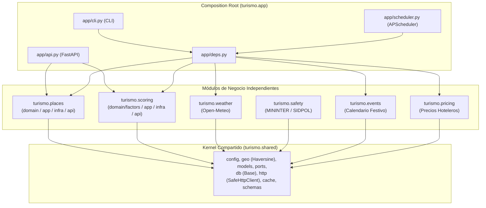
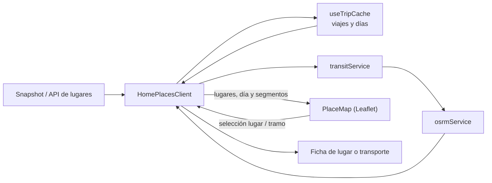

# Estructura y Funcionamiento del Sistema: Turismo La Libertad (Modular Monolith)

Este documento describe la arquitectura **Modular Monolith** con capas hexagonales por módulo de negocio, los flujos de datos y las reglas de gobernanza del sistema **Turismo La Libertad**.

---

## 1. Visión General y Principios de Arquitectura

**Turismo La Libertad** es una plataforma de planeamiento y recomendación turística inteligente para el departamento de La Libertad, Perú (Trujillo, Huanchaco, Otuzco, Pacasmayo, Huamachuco, etc.).

### Principios de Diseño
- **Modular Monolith por Contexto de Negocio:** El código se organiza por módulos funcionales (`places`, `scoring`, `weather`, `safety`, `events`, `pricing`), y dentro de cada módulo viven sus propias capas hexagonales (`domain`, `application`, `infrastructure`, `api`). Cada desarrollador trabaja en su módulo sin conflictos de merge.
- **Principio Open/Closed en Scoring (`ScoreFactor`):** Cada factor de scoring vive en su propio archivo bajo `src/turismo/scoring/domain/factors/` e implementa el protocolo `ScoreFactor`. Agregar un factor nuevo es agregar un archivo, no editar uno existente.
- **Único Composition Root (`src/turismo/app/`):** Los módulos de negocio no se importan entre sí; únicamente `turismo.app` (`api.py`, `deps.py`, `cli.py`, `scheduler.py`) los ensambla.
- **Fronteras Verificadas por Máquina:** Contratos `[tool.importlinter]` en `pyproject.toml` y tests AST en `tests/architecture/test_architecture_contracts.py` fallan en CI si el dominio importa infraestructura, si dos módulos hermanos se importan entre sí o si existen múltiples `heads` en Alembic.
- **Compatibilidad 100% Hacia Atrás:** Las rutas clásicas (`turismo.domain.*`, `turismo.application.*`, `turismo.infrastructure.*`, `turismo.interfaces.*`) actúan como fachadas ligeras de re-exportación hacia los paquetes modulares, evitando cualquier rotura en scripts, migraciones o tests existentes.

---

## 2. Estructura del Repositorio

```text
lalibertad_predict/
├── .github/
│   ├── CODEOWNERS                         # Responsables de revisión por módulo
│   ├── pull_request_template.md           # Plantilla de PR con checklist modular
│   └── workflows/ci.yml                   # Ruff + Mypy + Alembic Head + Pytest + Next.js Build
├── docs/
│   ├── architecture.md                    # Documentación de arquitectura (este documento)
│   └── adr/
│       └── 0001-modular-monolith-architecture.md
├── pyproject.toml                         # Dependencias, Ruff, Mypy e import-linter contracts
├── alembic.ini                            # Configuración de migraciones
├── migrations/                            # Historial de migraciones Alembic (único head)
├── config/                                # Configuración declarativa global
│   ├── classification.yaml
│   ├── events.yaml
│   └── weights.yaml                       # Sincronizado con src/turismo/scoring/weights.yaml
├── src/turismo/
│   ├── shared/                            # Kernel compartido: config, geo (Haversine), db, http, cache, schemas
│   ├── places/                            # Módulo Places (catálogo, clasificación, OSM, enricher, imágenes)
│   │   ├── domain/                        # models.py, classification.py
│   │   ├── application/                   # ports.py
│   │   ├── infrastructure/                # models.py, repository.py, osm_collector.py, enricher.py, image_collector.py
│   │   └── api.py                         # APIRouter propio (/places, /places/{id}, /places/{id}/nearby)
│   ├── scoring/                           # Módulo Scoring (conveniencia y recomendación)
│   │   ├── domain/
│   │   │   ├── models.py                  # FactorScore, normalize_linear, normalize_inverted, combine_factors
│   │   │   └── factors/                   # Un archivo por factor (Protocol ScoreFactor)
│   │   │       ├── base.py                # PlaceDayContext y ScoreFactor Protocol
│   │   │       ├── weather.py             # WeatherFactor
│   │   │       ├── marine.py              # MarineFactor
│   │   │       ├── calendar.py            # CalendarFactor
│   │   │       ├── seasonality.py         # SeasonalityFactor
│   │   │       ├── price.py               # PriceFactor
│   │   │       ├── safety.py              # SafetyFactor
│   │   │       ├── external_rating.py     # ExternalRatingFactor
│   │   │       └── recommendation.py      # Índice comercial para lodging/food/activity
│   │   ├── application/
│   │   │   ├── ports.py
│   │   │   └── engine.py                  # ScoringEngine (itera sobre ScoreFactor) y ScoringService
│   │   ├── infrastructure/                # models.py, repository.py, mincetur_collector.py
│   │   ├── weights.yaml                   # Configuración de pesos junto al módulo
│   │   └── api.py                         # APIRouter propio (/scores/{place_id}, /calendar)
│   ├── weather/                           # Módulo Weather (Open-Meteo clima y oleaje)
│   │   ├── domain/models.py
│   │   ├── application/ports.py
│   │   └── infrastructure/                # models.py, repository.py, open_meteo_collector.py
│   ├── safety/                            # Módulo Safety (MININTER / SIDPOL)
│   │   ├── domain/models.py
│   │   └── infrastructure/mininter_collector.py
│   ├── events/                            # Módulo Events (calendario festivo regional)
│   │   ├── domain/models.py
│   │   ├── application/ports.py
│   │   └── infrastructure/                # models.py, repository.py, events_collector.py
│   ├── pricing/                           # Módulo Pricing (precios históricos de hospedaje)
│   │   ├── domain/models.py
│   │   ├── application/ports.py
│   │   └── infrastructure/                # models.py, repository.py, hotel_prices_collector.py
│   └── app/                               # Composition Root: único lugar que conecta todos los módulos
│       ├── api.py                         # FastAPI: solo include_router de places y scoring + /health
│       ├── deps.py                        # Inyección de dependencias ensamblada
│       ├── cli.py                         # CLI: migrate, api, scheduler, collect, score
│       └── scheduler.py                   # APScheduler jobs
├── tests/                                 # Espejo de src/ + contratos de arquitectura
│   ├── architecture/                      # test_architecture_contracts.py (pureza, independencia, alembic head)
│   ├── places/                            # test_places_module.py
│   ├── scoring/                           # test_factors.py, test_weights_golden.py (golden regression test)
│   ├── unit/                              # Suite unitaria completa
│   └── integration/                       # Suite de integración de repositorios y API
└── frontend/
    └── src/
        ├── app/                           # App Router, estilos globales y páginas
        ├── components/                    # Mapa, planificador, fichas y UI
        ├── hooks/                         # Estado y persistencia de viajes
        ├── lib/                           # API, OSRM, transporte y optimización de rutas
        └── data/                          # Snapshot y catálogo complementario
```

---

## 3. Diagrama de Arquitectura Modular



---

## 4. Gobernanza, Flujo de Git y Prevención de Conflictos

1. **Ramas y Commits por Módulo:**
   - Ramas cortas con prefijo de módulo: `feat/scoring-factor-uv`, `fix/places-osm-timeout`.
   - Conventional Commits con scope: `feat(scoring): agrega factor UV`.
2. **Los Tres Puntos de Conflicto Mitigados:**
   - **`turismo.db`:** Excluido en `.gitignore`; se regenera con `migrate` + `seed`. Los seeds en `data/seeds/` sí se versionan en Git.
   - **Migraciones de Alembic:** El CI y `tests/architecture/test_architecture_contracts.py::test_alembic_has_single_head` verifican que exista exactamente un único `head`.
   - **`weights.yaml`:** Protegido por `tests/scoring/test_weights_golden.py`, que verifica que `config/weights.yaml` y `src/turismo/scoring/weights.yaml` estén sincronizados y valida los scores esperados (golden test) para detectar el impacto numérico exacto en cada PR.

---

## 5. Frontend: mapa y planificador

El mapa vive en el frontend, fuera de los contextos Python del monolito. El cliente del planificador reúne estado de viaje y resultados de transporte, y el componente de mapa los representa:



### Módulos frontend y contrato del mapa

- **`frontend/src/components/HomePlacesClient.tsx` (`HomePlacesClient`)**: conserva `selectedMapPlace`, `selectedTransitRoute`, `selectedLegId`, día y filtro de catálogo. `handleMapPlaceSelect` abre/carga la ficha; `handleMapTransitSelect` abre la ficha de transporte; `handleMapLegSelect` activa el tramo y coordina el desplazamiento del panel.
- **`frontend/src/components/PlaceMap.tsx` (`PlaceMap`)**: recibe `routePlaces`, `routeSegments`, `catalogPlaces`, `catalogKind`, `selectedPlace`, callbacks de selección, `hotelAnchor` y `selectedLegId`. Crea capas para catálogo y paradas; evita marcadores adicionales duplicados; conserva marcadores de catálogo cercanos (radio de 10 km respecto de una parada activa o el centro si no hay paradas).
- **`frontend/src/lib/transitService.ts`**: resuelve modo, empresa, línea, paraderos, costo y caminatas de acceso. Cuando el acceso a un micro/combi excede el umbral de 800 m, el fallback recomienda taxi en vez de presentar esa caminata como un acceso urbano normal.
- **`frontend/src/lib/osrmService.ts`**: solicita geometría pública OSRM para caminar o conducir; si no está disponible, la geometría devuelta es aproximada y no equivale a una ruta vial verificada.
- **`frontend/src/hooks/useTripCache.ts`**: persiste el planificador en el navegador; `addPlaceToDay` impide duplicar un mismo lugar dentro del mismo día.
- **`frontend/src/app/globals.css`**: establece el tamaño del lienzo Leaflet dentro de paneles flexibles y estiliza selección, pines y estado atenuado.

### Interacciones cartográficas

1. Los destinos del día aparecen numerados; el resto del catálogo cercano usa iconografía por tipo y el filtro del catálogo del planificador (`listCategory`).
2. Seleccionar un lugar notifica al cliente, centra/resalta el marcador y muestra una ficha con la acción para elegir viaje/día.
3. Las líneas de transporte, sus pines y los indicadores de caminata se enlazan al tramo (`legId`). Al seleccionar un tramo, los demás se atenúan y el mapa encuadra sus coordenadas.
4. Los controles **Itinerario**, **Vista general** y **Ampliar mapa** encuadran el día activo, restauran la vista inicial capturada tras la carga o expanden el mapa.
5. El mapa se reajusta ante cambios de tamaño con `ResizeObserver`; no sustituye un navegador GPS ni garantiza disponibilidad de rutas u horarios.

La referencia de interacciones y responsabilidades por función está ampliada en [ESTRUCTURA_DEL_SISTEMA.md](../ESTRUCTURA_DEL_SISTEMA.md). Los cambios de alcance grande se registran en [CHANGELOG.md](../CHANGELOG.md).
